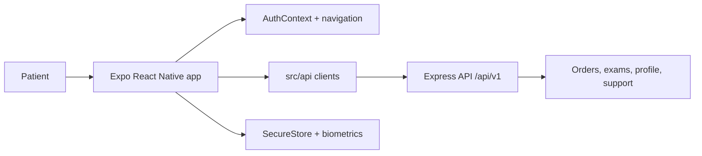

# CPO Conecta

Mobile patient experience for a clinical laboratory. Patients can authenticate, review laboratory orders and exam statuses, download validated results as PDFs, contact the support assistant, and manage profile and biometric access.

This repository contains the Expo React Native frontend. The API is maintained in the [`server/`](server/) backend repository.

## Features

- Username/password registration and sign-in.
- Optional biometric sign-in through the device credential vault.
- Latest order, exam status summary, and order history.
- PDF result downloads and sharing.
- Authenticated support chat with a keyword fallback and optional server-side Gemini integration.
- Profile, password, session timeout, app lock, and logout flows.

## Technology

- Expo and React Native
- TypeScript
- React Navigation
- Expo SecureStore and LocalAuthentication
- Expo FileSystem and Sharing
- Outfit font and a shared dark visual theme

The declared mobile dependencies currently target Expo SDK 58 and React Native 0.88.1. Check the repository instructions before making source changes.

## Run locally

```bash
npm install
npm start
```

Then choose a development target:

```bash
npm run android
npm run ios
npm run web
```

The frontend reads its API endpoint from [`src/constants/api.ts`](src/constants/api.ts). For a physical device, replace the hosted URL with the backend's LAN address, for example `http://192.168.1.10:4000/api/v1`. Android emulators can use `http://10.0.2.2:4000/api/v1` to reach the host machine.

## Application structure

```text
App.tsx
src/
├── api/           HTTP clients and API response mapping
├── components/    Reusable UI components
├── constants/     API endpoint and application constants
├── context/       Session and toast state
├── hooks/         Refresh, inactivity, keyboard, and font hooks
├── navigation/    Root stack and bottom tabs
├── screens/       Login, registration, results, PDFs, support, and profile
├── security/      Biometric flows and SecureStore access
├── theme/         Colors, typography, spacing, and theme exports
├── types/         Shared frontend data shapes
└── utils/         Formatting, validation, and PDF download helpers
```



## Security notes

- The normal JWT session is kept in memory and is not persisted by the frontend.
- Biometric device credentials are stored through Expo SecureStore and are only read after biometric authentication.
- The Gemini API key, when enabled, belongs to the backend and is never shipped to the app.
- Do not place production credentials or patient data in the repository.

## Documentation

- [Frontend implementation guide](docs/frontend.md)
- [Project overview](docs/main.md)
- [Architecture package](docs/architecture/architecture.md)
- [Authentication and biometric access](docs/use-cases/authentication.md)
- [Results and order history](docs/use-cases/results-and-order-history.md)
- [PDF result download](docs/use-cases/pdf-download.md)
- [Support chat](docs/use-cases/support-chat.md)
- [Profile and password management](docs/use-cases/profile-management.md)
- [Backend README](server/README.md)

## Build configuration

Expo app metadata is in [`app.json`](app.json), and EAS profiles are in [`eas.json`](eas.json). No production deployment or availability guarantees are inferred from these files alone.

