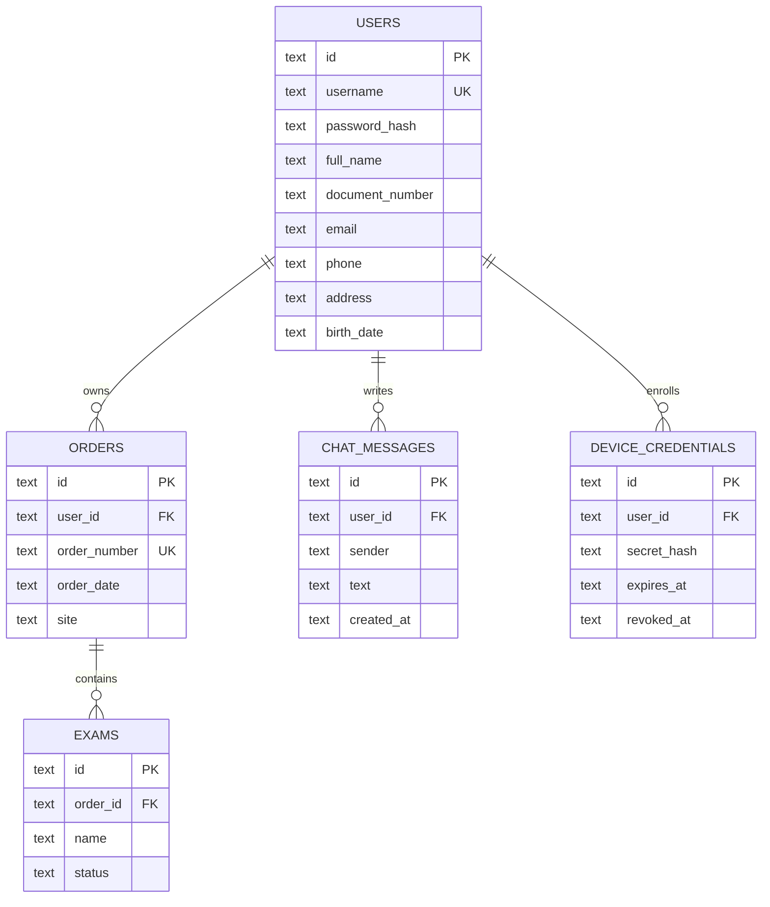

# CPO Conecta — Architecture Documentation

## 1. Product context and scope

CPO Conecta is a patient-facing laboratory results application. The implemented experience lets an authenticated patient view the latest laboratory order, browse order history, see exam states (`ready`, `processing`, `issue`), download validated results as PDF, use an authenticated support chat, and manage profile, password, and biometric access.

This package describes the repository as inspected on 2026-11-10. It separates the logical application architecture from hosting views. It does not claim a verified production deployment, availability level, compliance posture, or target-cloud implementation.

## 2. Evidence status legend

| Status | Meaning in this document |
| --- | --- |
| Verified | Directly supported by current source/configuration relationships |
| Configured | Present as a runtime/build setting, but not independently runtime-verified |
| User-reported | Supplied in the request or project context |
| Inferred | Interpretation of multiple implementation facts, stated narrowly |
| Proposed | Target design required by the architecture package; not current evidence |
| Unknown | Not established by the inspected repository |

## 3. Logical components

The cloud-agnostic component view is available as [Mermaid](component-diagram.mmd) and editable [Draw.io](component-diagram.drawio). They represent the same logical topology:

- Patient uses the Expo React Native client.
- Client API modules call the versioned Express API with a Bearer JWT.
- Express applies cross-cutting middleware before controllers.
- Controllers delegate to application services.
- Services call repositories for SQLite data, PDF generation for binary results, and optionally Gemini for support responses.

The `server/src/app.ts` composition and `server/src/routes` registration verify the request boundary. Service/repository imports and the database module verify the internal relationships. The Gemini edge is conditional on `GEMINI_API_KEY` and falls back to keyword responses when unavailable.

## 4. Functional interactions and data paths

| Interaction | Evidence status | Evidence |
| --- | --- | --- |
| Patient → mobile screens | Verified + user-reported product context | `src/screens/*`, navigation, request |
| Mobile → `/api/v1` | Configured and verified in client API modules | `src/constants/api.ts`, `src/api/*` |
| JWT-protected requests | Verified | `authMiddleware.ts`, `apiClient.ts`, route middleware registration |
| Orders/exams → SQLite | Verified | order/exam services and repositories, `schema.ts` |
| Result → PDF bytes → client | Verified | `resultsPdfDocument.ts`, controllers, `pdfApi.ts` |
| Chat → Gemini | Conditional/configured | `geminiClient.ts`, `env.ts`, `chatService.ts` |
| Chat → keyword fallback | Verified | `keywordAssistant.ts`, `chatService.ts` |

## 5. Frontend architecture

The frontend is a React Native composition rooted at `App.tsx`:

`SafeAreaProvider → StatusBar → AuthProvider → ToastProvider → AppNavigator → AppLockGate + SessionGuard`.

Navigation is a root native stack with a bottom-tab application area. API access is centralized in `src/api`; security helpers isolate native biometric and SecureStore behavior; screen-level hooks manage loading, refresh, optimistic chat updates, and retry states. See [frontend documentation](../frontend.md).

## 6. Backend architecture

The backend is an Express/TypeScript service with explicit layers: configuration, routes, middlewares, controllers, services, repositories, exceptions, utilities, and types. `server.ts` runs migrations and seed logic before listening. The database is a singleton `better-sqlite3` connection to a file path from `DATABASE_PATH`.

The implementation uses SQL repositories rather than an ORM. Domain ownership is enforced by repository queries and service inputs using the authenticated user id. Central error handling exposes typed errors and hides unexpected internal details, except for an optional development debug message.

## 7. Data model

## 8. Security and operational behavior

Verified behaviors include bcrypt password hashing, JWT verification, patient-scoped queries, failed-login throttling, biometric token hashing and rotation, password-change revocation, Helmet, CORS validation, SQLite foreign keys, and WAL mode. The support rate limiter is in memory; it resets on restart. No test suite, monitoring configuration, backup policy, or incident process was found.

## 9. Current/reported hosting view

`src/constants/api.ts` configures `https://cpo-conecta-api.onrender.com/api/v1`. This is a configured endpoint hostname and is documented as a reported/current integration view, not as independently verified deployment. See [current-deployment.drawio](current-deployment.drawio).

## 10. Proposed AWS target view

Because no target cloud was requested, the required provider-specific diagram defaults to a **PROPOSED AWS** view. It is not a claim that AWS resources exist. The diagram keeps the mobile client and optional Gemini system external, places an API ingress and Node API workload inside the proposed AWS boundary, and shows file-backed persistence as an explicit unresolved design concern because the implementation currently uses SQLite.

See [aws-infrastructure.drawio](aws-infrastructure.drawio). Region, account, and subnet placement are labeled `TBD`.

### AWS icon inventory

| Diagram label | Markup/source | Status and fallback |
| --- | --- | --- |
| Amazon API Gateway | Verified AWS4 stencil `mxgraph.aws4.api_gateway`, based on the installed architecture examples and AWS4 guidance | Proposed service icon |
| Amazon ECS | Verified AWS4 stencil `mxgraph.aws4.ecs`, listed in the installed AWS4 guidance | Proposed service icon representing the Node API workload |
| Amazon CloudWatch | Verified AWS4 stencil `mxgraph.aws4.cloudwatch_2`, based on the installed architecture examples and AWS4 guidance | Proposed observability destination |
| Amazon EFS | Editable labeled service card | Fallback: exact stencil was not verified in the inspected AWS4 guidance; the label remains explicit and the placement is proposed |

The AWS diagram was structurally checked with the bundled Draw.io checker. No rendered Draw.io preview was requested or performed.

## 11. Decisions and gaps

- Versioned API routing (`/api/v1`) is verified and leaves room for future versions without changing the current route mount.
- Repository isolation is verified: SQL is concentrated in repositories, while services hold application rules.
- The current SQLite file is appropriate evidence for the present implementation but creates an unresolved durability/scaling question for a multi-instance target deployment.
- Expo dependencies currently declare SDK 58 while `AGENTS.md` instructs contributors to read Expo v57 docs before code changes. This documentation package did not modify application code; the version policy should be clarified before implementation work.
- Deployment, CI/CD, tests, runtime metrics, backups, and infrastructure-as-code are unknown.

## 12. Related artifacts

- [Project/backend overview](../main.md)
- [Frontend documentation](../frontend.md)
- [Project Blueprint](../project-blueprint.html)
- [Presentation](../../examples/presentations/cpo-conecta-architecture.html)
- [Component Mermaid](component-diagram.mmd)
- [Component Draw.io](component-diagram.drawio)
- [Proposed AWS infrastructure Draw.io](aws-infrastructure.drawio)
- [Current configured-host Draw.io](current-deployment.drawio)
