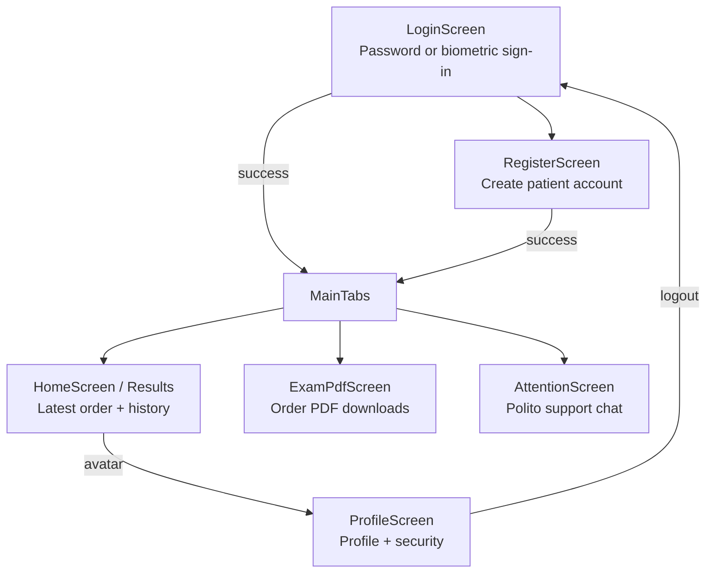

# CPO Conecta — Frontend Documentation

## Scope

The frontend is an Expo React Native application declared in the repository root. `App.tsx` composes the safe-area provider, light status bar, authentication context, toast context, navigation, inactivity lock, and session-expiration guard.

## Navigation and screens

`AppNavigator` owns the root stack: `Login`, `Register`, `Main`, and `Profile`. `MainTabs` owns the `Results`, `ExamPdf`, and `Attention` tabs. The custom tab bar and dark theme are implemented in `src/components/navigation`, `src/theme`, and related screen files.

## Screen behavior

### Login and registration

- `LoginScreen` supports username/password sign-in and biometric sign-in when a device credential is available.
- `RegisterScreen` submits the patient fields required by `POST /auth/register`.
- Successful password or biometric authentication starts the in-memory session and navigates to the main tabs.
- Server errors are rendered in the form; session invalidation is handled globally by `SessionGuard`.

### Results

`HomeScreen` has two local segments:

- `Inicio` loads `GET /orders/latest`, showing the order header, laboratory site/date, status summary, and exam rows.
- `Historial` loads `GET /orders` only when selected and renders orders with their exams through `OrderHistory`.

Both states support loading, retryable error, empty, and ready presentations. Pull-to-refresh calls the active loader.

### Exam PDF

`ExamPdfScreen` loads all orders and offers one PDF action per order. If an order has pending or issue exams, the app asks for confirmation before downloading. The backend returns only validated exams in the generated order PDF. `pdfDownloads.ts` saves to a selected folder when supported, otherwise invokes the platform share sheet. Toasts report success and failure.

### Attention

`AttentionScreen` loads the authenticated conversation from `GET /support/messages`. A submitted message is displayed optimistically, then replaced by the server-confirmed user message and assistant response from `POST /support/messages`. The UI keeps working with a local error bubble when a message fails; global session expiry remains handled by `SessionGuard`.

### Profile

`ProfileScreen` loads and renders the authenticated profile, supports editing contact fields, changing the password, toggling biometric access, and logging out. A successful password change clears the local biometric enrollment state because the backend revokes all device credentials.

## Client API boundary

The client API modules map to backend responsibilities:

| Client module | Calls |
| --- | --- |
| `authApi.ts` | Login, register, profile read/update, password update |
| `biometricApi.ts` | Enroll, login, revoke device credential |
| `ordersApi.ts` | Latest order and order history |
| `pdfApi.ts` | Binary order PDF download |
| `supportApi.ts` | Support history and message submission |
| `apiClient.ts` | JSON request timeout, Bearer token, JSON error parsing, session event |

The client timeout is configured to 70 seconds because the source comments anticipate a slow free host wake-up. This is configuration, not a measured service-level objective.

## State and security model

- `AuthContext` holds the public user and JWT in React memory. The normal session JWT is not persisted to disk.
- `biometricVault.ts` stores device credential material and account metadata in Expo SecureStore with device-only keychain accessibility.
- `biometricGate.ts` requires native biometric authentication before the device credential can be read.
- `AppLockGate` and `useInactivityTimeout` protect the visible app after inactivity.
- `SessionGuard` listens for `SESSION_INVALID` and returns the user to login.
- `ToastContext` provides cross-screen feedback such as PDF download status.

The code documents biometric behavior and secure storage usage. Device-level configuration, platform hardware behavior, and an independent security review remain unverified.

## Frontend evidence map

| Claim | Evidence |
| --- | --- |
| Root providers and guards | `App.tsx` |
| Root and tab navigation | `src/navigation/AppNavigator.tsx`, `src/navigation/MainTabs.tsx` |
| Result/history behavior | `src/screens/HomeScreen.tsx`, `src/api/ordersApi.ts` |
| PDF behavior | `src/screens/ExamPdfScreen.tsx`, `src/api/pdfApi.ts`, `src/utils/pdfDownloads.ts` |
| Support behavior | `src/screens/AttentionScreen.tsx`, `src/api/supportApi.ts` |
| Profile/security behavior | `src/screens/ProfileScreen.tsx`, `src/context/AuthContext.tsx`, `src/security/*` |
| API host and timeout | `src/constants/api.ts` |
