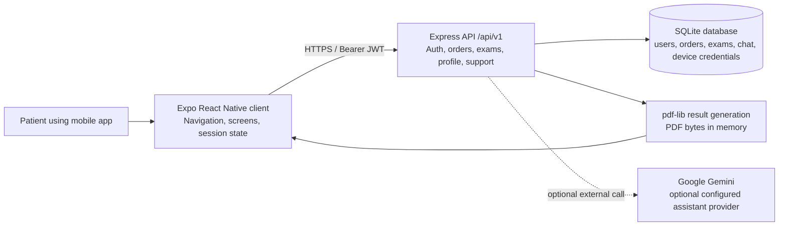

# CPO Conecta — Project and Backend Documentation

## Purpose and scope

CPO Conecta is a mobile patient experience for a clinical laboratory. A patient can sign in, review the latest laboratory order and its exam statuses, browse order history, download validated results as PDFs, contact the support assistant, and maintain profile and sign-in settings.

This document describes the implementation inspected in the repository on 2026-11-10. The repository contains two applications:

- `src/`: Expo React Native client.
- `server/`: Node.js, Express, TypeScript API with SQLite persistence.

The product description above is supported by the client screens, API clients, route registrations, controllers, services, repositories, and the user-supplied description. Hosting beyond the configured API URL is not treated as proven deployment.

## System overview

The logical component view is maintained in [architecture/component-diagram.mmd](architecture/component-diagram.mmd) and [architecture/component-diagram.drawio](architecture/component-diagram.drawio).

## Backend architecture as implemented

The backend follows observable layers rather than a framework-enforced architecture:

1. `config/` loads and validates environment values, opens the singleton SQLite connection, and runs schema migrations.
2. `routes/` mounts versioned endpoints under `/api/v1`.
3. `middlewares/` handles logging, JSON parsing, input validation, JWT authentication, 404 responses, and centralized errors.
4. `controllers/` translate HTTP requests into service calls and shape JSON or PDF responses.
5. `services/` implement authentication, order/exam rules, profile changes, biometric credentials, support chat, and PDF generation.
6. `repositories/` are the only layer that contains SQL access to SQLite.
7. `exceptions/`, `utils/`, and `types/` provide typed errors, JWT/password/file helpers, and shared data shapes.

The normal request path is `route → middleware → controller → service → repository`; `errorHandler` converts typed errors to the public error envelope.

## API surface

Base path: `/api/v1`.

| Area | Implemented routes | Authentication |
| --- | --- | --- |
| Health | `GET /health` | Public |
| Authentication | `POST /auth/register`, `POST /auth/login` | Public |
| Biometric sign-in | `POST /auth/biometric/enroll`, `POST /auth/biometric/login`, `POST /auth/biometric/revoke` | Enroll requires JWT; login/revoke use device token |
| Orders | `GET /orders`, `GET /orders/latest`, `GET /orders/:orderNumber/pdf/file` | JWT |
| Exams | `GET /exams`, `GET /exams/:examId/pdf`, `GET /exams/:examId/pdf/file` | JWT |
| Profile | `GET /profile`, `PATCH /profile`, `PATCH /profile/password` | JWT |
| Support | `GET /support/messages`, `POST /support/messages` | JWT |

The route and controller sources are the authority for this list. `server/README.md` is corroborating documentation and contains some duplicated table rows; those duplicates are not repeated here.

## Persistence and domain data

The schema in `server/src/config/schema.ts` defines:

- `users`: identity, password hash, and optional profile fields.
- `orders`: patient-owned six-digit order number, visit date, and laboratory site. A patient has at most one order per date.
- `exams`: exams belonging to an order, with `ready`, `processing`, or `issue` status.
- `chat_messages`: patient-scoped support conversation history.
- `device_credentials`: hashed device secrets, expiry, revocation timestamps, and revocation reasons for biometric access.

Foreign keys are enabled, the database uses WAL mode, and the file is created at the configured `DATABASE_PATH` (default `./data/cpo-conecta.db`). Migrations are run during server bootstrap before seeding.

## Security behavior supported by code

- Passwords are hashed with bcrypt; password hashes are not returned to the client.
- Protected routes require `Authorization: Bearer <JWT>` and resolve the user from the token subject.
- JWTs default to a two-hour expiry and the production secret must be distinct from the development secret and at least 32 characters.
- Five failed password attempts cause a 15-minute per-user lockout. Unknown users use a dummy hash comparison to reduce username-timing disclosure.
- Biometric device credentials are random tokens; only the secret hash is stored. Successful device login rotates the credential, and reuse of a rotated token revokes all credentials for that patient.
- Changing a password revokes all biometric device credentials.
- Helmet and CORS are configured at the Express boundary. Production rejects wildcard CORS.
- Exam and order lookups are scoped to the authenticated patient and return not-found behavior for another patient's record.

These are implementation behaviors, not a security certification. No automated security test suite was found in the inspected repository.

## Frontend integration

The frontend uses `src/api/apiClient.ts` for JSON requests, adds the Bearer token when available, maps API failures to `ApiError`, and emits a session-invalid event for the `SESSION_INVALID` error code. PDF downloads use a separate binary path and then save or share the bytes with Expo file and sharing APIs.

The configured API base URL is `https://cpo-conecta-api.onrender.com/api/v1` in `src/constants/api.ts`. This is configuration evidence for a reported/current host, not independent proof that the endpoint is reachable or that it is production-ready. Local development comments also document localhost, Android emulator, and LAN alternatives.

See [frontend.md](frontend.md) for screen, navigation, state, security, and integration details.

## Implemented use cases

- [Authentication and biometric access](use-cases/authentication.md)
- [Results and order history](use-cases/results-and-order-history.md)
- [PDF result download](use-cases/pdf-download.md)
- [Support chat](use-cases/support-chat.md)
- [Profile and password management](use-cases/profile-management.md)

## Technology and runtime inventory

| Concern | Observed implementation |
| --- | --- |
| Mobile runtime | Expo SDK dependency `^58.0.0`, React Native `0.88.1`, React `19.3.0` as declared in `package.json` |
| Mobile navigation | React Navigation native stack and bottom tabs |
| Mobile security/storage | `expo-local-authentication`, `expo-secure-store`, in-memory JWT session |
| Mobile files | `expo-file-system`, `expo-sharing` |
| API runtime | Node.js + Express + TypeScript (`server/package.json`) |
| Validation | Zod schemas in `server/src/validators` |
| Persistence | `better-sqlite3` with hand-written SQL |
| PDF generation | `pdf-lib` |
| Assistant integration | Optional Google Gemini REST call; keyword fallback is implemented |
| Build/deployment configuration | `eas.json` exists; no infrastructure-as-code or CI workflow was found |

## Evidence gaps and limitations

- No tests, OpenAPI specification, database snapshot, or runtime health check was found in the repository inspection.
- The app package declares Expo 58 while `AGENTS.md` asks contributors to consult Expo v57 documentation before writing code. This documentation task did not change source code; the version discrepancy should be resolved before a future code change.
- The API URL is configured for Render, but deployment configuration, logs, domain ownership, uptime, and TLS behavior were not available in the repository.
- The backend stores SQLite in a local file. A durable multi-instance production deployment is not evidenced.
- Gemini is optional and depends on a server-only environment variable. The repository cannot prove whether it is enabled in the configured host.
- No UI screenshots or browser/device render review was available; UX descriptions are derived from the React Native source.

## Documentation change summary

Created an evidence-based project overview, frontend guide, backend use-case guides, architecture package, presentation, and visual Project Blueprint. No application source or deployment configuration was modified.
