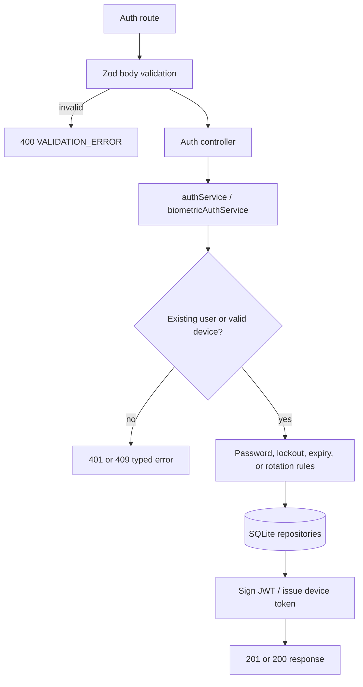

# Use case: Authentication and biometric access

## Entry points

- `POST /api/v1/auth/register`
- `POST /api/v1/auth/login`
- `POST /api/v1/auth/biometric/enroll`
- `POST /api/v1/auth/biometric/login`
- `POST /api/v1/auth/biometric/revoke`

## Main behavior

Registration validates all patient fields, rejects duplicate username or document, hashes the password, creates the user, creates a starter order with eight processing exams, and returns a public user plus JWT. Password login normalizes the username, applies the failed-login throttle, compares bcrypt hashes, and returns a public user plus JWT. Unknown users receive the same generic credential error and are compared against a dummy hash.

Biometric enrollment requires an existing JWT and a second password confirmation. The server creates a random device credential and stores only its secret hash. Biometric login verifies the device token, rejects expired or revoked credentials, rotates a valid credential, and returns a normal JWT plus a new device token. Reuse of a rotated token revokes all device credentials for the patient. Revoke is intentionally idempotent from the public API and returns `204`.

## Flow

## Evidence

`server/src/routes/v1/auth.routes.ts`, controllers in `server/src/controllers/authController.ts` and `biometricController.ts`, services `authService.ts` and `biometricAuthService.ts`, validators in `server/src/validators`, and the client calls in `src/api/authApi.ts` and `src/api/biometricApi.ts`.

## Important errors

Validation returns `400`. Invalid credentials return `401`; duplicate username/document returns `409`; the failed-login throttle can return `429`. A missing, expired, or invalid JWT is normalized to `SESSION_INVALID` by the auth middleware.
