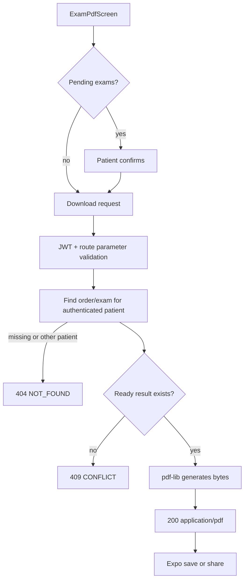

# Use case: PDF result download

## Entry points

- `GET /api/v1/orders/:orderNumber/pdf/file`
- `GET /api/v1/exams/:examId/pdf`
- `GET /api/v1/exams/:examId/pdf/file`

## Main behavior

Order downloads validate a six-digit order number and patient ownership, select only `ready` exams, and generate one PDF in memory with `pdf-lib`. If no exam is ready, the service returns `409`. Exam downloads apply the same ownership/status rules and generate a single-exam PDF. Successful responses are binary PDF bytes with `Content-Disposition` and a safe filename; metadata requests return JSON before a file is requested.

The mobile app asks for confirmation when an order is incomplete, downloads the binary response with the Bearer token, then saves or shares it through Expo file APIs.

## Flow

## Evidence

`server/src/services/orderService.ts`, `examService.ts`, `services/pdf/resultsPdfDocument.ts`, `src/screens/ExamPdfScreen.tsx`, `src/api/pdfApi.ts`, and `src/utils/pdfDownloads.ts`.
