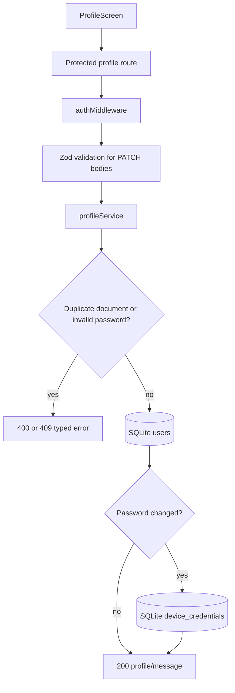

# Use case: Profile and password management

## Entry points

- `GET /api/v1/profile`
- `PATCH /api/v1/profile`
- `PATCH /api/v1/profile/password`

## Main behavior

The profile endpoints always act on the user represented by the JWT. The profile response omits the password hash. The update schema allows optional profile fields; an empty string is transformed to `null`, so a patient can clear a value. A duplicate document number is rejected with `409`. Password changes compare the current password, require a different new password, hash the new password, and revoke all biometric device credentials.

The frontend loads the profile when `ProfileScreen` opens, updates the session greeting after a successful profile save, and informs the patient when a password change disables biometric access.

## Flow

## Evidence

`server/src/routes/v1/profile.routes.ts`, `profileController.ts`, `profileService.ts`, profile validators, `userRepository.ts`, and `src/screens/ProfileScreen.tsx`.
