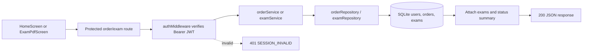

# Use case: Results and order history

## Entry points

- `GET /api/v1/orders/latest`
- `GET /api/v1/orders`
- `GET /api/v1/exams`

## Main behavior

All three endpoints require a JWT. The authenticated user id is passed into repositories, so the service returns only that patient's orders and exams. Orders are enriched with their exams and a `ready` / `processing` / `issue` summary. The latest-order endpoint returns `null` when the patient has no orders.

The mobile `HomeScreen` uses the latest-order endpoint for `Inicio`, loads all orders lazily for `Historial`, and supports retry and pull-to-refresh states. `ExamPdfScreen` also uses the order list to show downloadable order cards.

## Flow

## Evidence

`server/src/routes/v1/order.routes.ts`, `exam.routes.ts`, controllers `orderController.ts` and `examController.ts`, services `orderService.ts` and `examService.ts`, and `src/screens/HomeScreen.tsx`.
