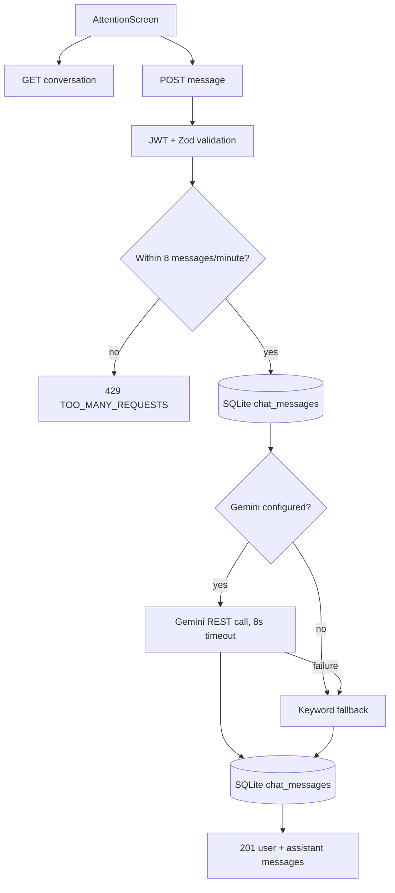

# Use case: Support chat

## Entry points

- `GET /api/v1/support/messages`
- `POST /api/v1/support/messages`

## Main behavior

The authenticated patient can load up to the latest 100 saved messages. A new message is trimmed and limited to 500 characters, rate-limited to eight messages per minute per user, saved, answered, and saved again with the assistant response.

When `GEMINI_API_KEY` is configured, the server sends Gemini a system prompt containing the assistant rules, the patient's first name, up to five recent orders and their exam statuses, and recent conversation context. It intentionally omits the patient's document, phone, email, address, and birth date. If Gemini is not configured or fails, the keyword assistant supplies the fallback response.

## Flow

## Evidence

`server/src/services/chatService.ts`, `services/assistant/*`, `chatRepository.ts`, `supportValidators.ts`, `chatController.ts`, and `src/screens/AttentionScreen.tsx`.

## Limitations

The rate limiter is in memory and resets when the server restarts. The repository does not prove whether Gemini is enabled on the configured host.
